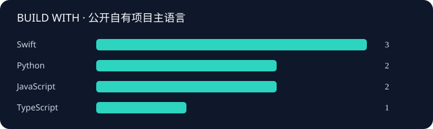

# Hi, I’m Daniel 👋

**把好奇心写成代码，把重复的事交给工具。**

在 Apple 生态、自动化与网络工具之间持续探索，
把日常遇到的小问题，做成可复用、可维护的小作品。

[项目地图](docs/PROJECTS.md) · [非公开项目](docs/PRIVATE_PROJECTS.md) · [数据与口径](docs/METRICS.md) · [访问归档](docs/TRAFFIC.md) · [兴趣画像](docs/INTERESTS.md) · [更新指南](docs/MAINTENANCE.md)

## 正在构建的作品

> 从一个具体需求出发，让工具真正融入日常。

- **[DeviceMapping](https://github.com/danielgzd/DeviceMapping)** · iOS 设备名称查询：远端更新、离线兜底，让机型适配更轻松。
- **[Cloudflare-SpeedTest-BestIP](https://github.com/danielgzd/Cloudflare-SpeedTest-BestIP)** · Cloudflare IP 测速与优选工具。
- **[Cloudflare-SpeedTest-BestIP-For-iStoreOS](https://github.com/danielgzd/Cloudflare-SpeedTest-BestIP-For-iStoreOS)** · 面向 iStoreOS 场景的 Cloudflare IP 优选项目。
- **[MyAutoScript](https://github.com/danielgzd/MyAutoScript)** · 把重复操作交给自动化脚本。
- **[proxy-rules](https://github.com/danielgzd/proxy-rules)** · 整理跨客户端的网络分流规则与配置。

## 幕后也在生长的作品

有些项目仍在打磨，有些服务于个人工作流。这里保留它们的开发足迹，代码继续私有。

| 项目与更新记录 | 基本介绍 |
| --- | --- |
| [LumaCapture-Commercial](docs/private-projects/LumaCapture-Commercial.md) | 面向 macOS 的截图、录屏与标注应用商业版本。 |
| [MarkdownTextToolPro](docs/private-projects/MarkdownTextToolPro.md) | Swift 项目，功能介绍待补充。 |
| [MyDocBackup](docs/private-projects/MyDocBackup.md) | 个人文档备份项目，仅展示维护活动。 |
| [Notes](docs/private-projects/Notes.md) | 个人笔记项目，仅展示维护活动。 |
| [Rules](docs/private-projects/Rules.md) | 网络规则整理项目。 |
| [SoundSync](docs/private-projects/SoundSync.md) | Swift 项目，功能介绍待补充。 |
| [StardustPost](docs/private-projects/StardustPost.md) | 自主部署的即时通讯系统，采用本地优先与单二进制部署方式。 |
| [TranslateBox](docs/private-projects/TranslateBox.md) | 离线优先的个人翻译与实时字幕工具，面向 iOS、iPadOS 与 watchOS。 |

私有项目快照：2026-10-30T03:34:56+00:00 · [查看完整统计与更新记录](docs/PRIVATE_PROJECTS.md)

## 项目与开发足迹

| 指标 | 当前快照 |
| :--- | ---: |
| 公开仓库（包含本首页） | 69 |
| 公开自有非 Fork 项目（不含首页） | 11 |
| Fork 探索仓库 | 57 |
| 公开自有项目获得 Star | 4 |
| 公开自有项目被 Fork | 1 |
| Followers / Following | 3 / 10 |
| 公开自有项目已归档 | 0 |
| 公开自有项目开放 Issue + PR | 0 |
| 私有项目（已纳入展示） | 8 |
| 已统计仓库合计（公开 + 私有） | 77 |
| 自有项目合计（公开 + 私有，不含首页与 Fork） | 19 |
| 私有项目近 365 天默认分支提交（所有作者） | 60 |
| 近一年公开贡献 | 640 |
| 近一年 Commit 贡献 | 621 |
| 近一年 PR / Issue / Review 贡献 | 1 / 3 / 0 |
| 近一年有贡献的天数 | 175 |

贡献快照时间：2026-10-30 11:31 UTC+8

语言按公开自有非 Fork 项目的主语言计数，不代表代码行数或熟练程度。Commit 为 GitHub 贡献口径，非全平台、全分支的历史提交总量。

## 我的探索地图

| 方向 | 公开自有项目 | Fork 收藏 | 私有项目 |
| :--- | ---: | ---: | ---: |
| Apple 生态与效率工具 | 3 | 7 | 3 |
| 影音与数字生活 | 0 | 7 | 0 |
| 网络与自托管 | 3 | 16 | 2 |
| AI 与开发工具 | 0 | 3 | 0 |
| 自动化与日常脚本 | 1 | 16 | 0 |
| Web 与交互创作 | 1 | 3 | 0 |
| 其他探索 | 3 | 2 | 1 |
| 学习与知识收藏 | 0 | 3 | 2 |

从公开仓库看，我的探索集中在 **Apple 生态、网络配置与自动化**。这是一份可修正的项目兴趣地图；Fork 表达关注，不代表参与开发、实际使用或认可项目的全部功能。

## 最近更新

- [DeviceMapping](https://github.com/danielgzd/DeviceMapping) · 2026-10-30 · Swift
- [Cloudflare-SpeedTest-BestIP](https://github.com/danielgzd/Cloudflare-SpeedTest-BestIP) · 2026-10-29 · Python
- [danielgzd.github.io](https://github.com/danielgzd/danielgzd.github.io) · 2026-10-29 · TypeScript
- [proxy-rules](https://github.com/danielgzd/proxy-rules) · 2026-10-29 · JavaScript
- [MyAutoScript](https://github.com/danielgzd/MyAutoScript) · 2026-10-29 · Python

---

公开数据更新于 2026-10-30 11:37 UTC+8 · 每日自动整理 · MIT License

访客徽章来自第三方，记录图片请求次数，受缓存影响，并非独立访客数。私有项目仅发布已配置的基本介绍与按日提交次数，源码保持私有。
